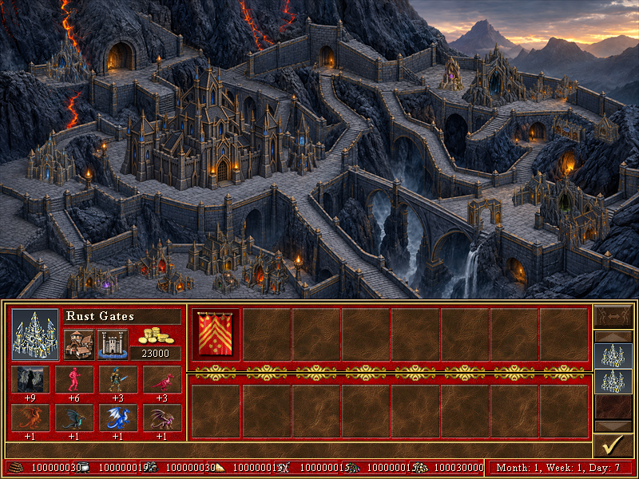

# Dragon Citadel

A mountain town built around foundries, narrow passes and rival dragon broods. The mod includes third creature forms, optional fourth forms and a campaign of eight chapters.

**Playable release:** [1.5.9](https://github.com/czcmjkfvy4-dotcom/Jakubabuba/releases/tag/v1.5.9). **This branch:** unreleased 1.5.10 editorial candidate. Town artwork is still being revised.

## Play

1. Download the complete installer from the 1.5.9 release assets.
2. Provide your own Heroes III Complete game data.
3. Start the Dragon Citadel launcher. Choose a language and enable optional fourth forms or the graphics submod if wanted.

The supported languages are Polish, English, German, Simplified Chinese, Japanese, Russian, Spanish and French. The first use of a base-game language pack requires internet access. The installer checks downloaded packs against pinned checksums.

**The complete rules require BILLADENC4, based on VCMI 1.7.5.** Adding the mod to a stock VCMI launcher does not install that engine. See [compatibility](docs/compatibility.md) before using the extra repository.

[Polski opis i instalacja](README.pl.md)

## What changes in this branch

Sixteen hero biographies previously repeated a technical description of joining the faction. They now describe individual duties and choices within the Citadel. All eight language files are updated. The source hero definitions use English text instead of damaged Polish fallbacks; skills, specialties and armies are unchanged.

> Arlach measures every bridge before bringing his ballista across. A weapon lost to haste cannot defend the Citadel.

These are stories written for this mod, not additions to official Heroes III canon. Translation editing was assisted by AI; a full native-speaker review is still pending.

## Status

This remains a development project. Small buildings and the visual fit of parts of the town still need work. Campaign victory objectives have been reached in separate automated trials; continuous campaign carryover and a full manual playthrough have not been certified. See [known issues](docs/known-issues.md) and the [1.5.10 verification record](qa-1.5.10/README.md).

The official VCMI catalog submissions were closed without acceptance. The extra repository is maintained independently:

`https://raw.githubusercontent.com/czcmjkfvy4-dotcom/Jakubabuba/main/repository.json`

## Feedback and credits

Please report the engine version, mod version, enabled submods, steps to reproduce and expected result. For town artwork, identify the building and upgrade stage and attach an actual game screenshot. The issue forms ask for these details.

Project direction: Billaden. See [credits and development tools](docs/credits-and-tools.md), [resource credits](TUM-RESOURCE-CREDITS.txt) and the bundled font and submod notices. Original Heroes III game data is not included in the installer.
